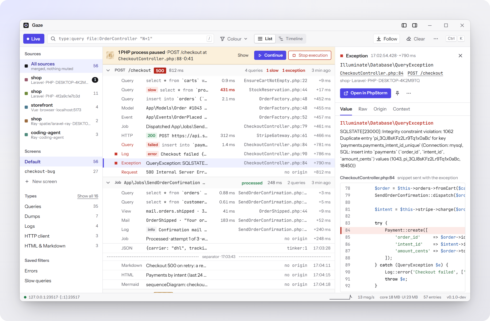

# thewonderjoy/gaze-php

Send values from any PHP code to the Gaze desktop app. Like `ray()`, but called `gaze()`.

Gaze is a fast debug window for PHP, Laravel and JavaScript (Windows first). This is its plain PHP client. Using Laravel? Install [`thewonderjoy/gaze-laravel`](https://packagist.org/packages/thewonderjoy/gaze-laravel) instead; it includes this package.



Requires PHP 8.2+ with `curl` and `json`.

```bash
composer require thewonderjoy/gaze-php
```

This is a normal dependency, as spatie/ray recommends. It turns itself off when `APP_ENV` is `production` or `prod`: `gaze()` then returns a no-op object and nothing else of the package is loaded, so a `gaze()` or `gaze_dd()` call you forgot to remove does nothing on a live server (`gaze_dd()` doesn't exit). If you add `--dev` instead, a forgotten call becomes a fatal error in production, so run `vendor/bin/gaze clean` before you deploy.

## Use

```php
gaze('Hello', $user, ['a' => 1]);              // one entry, three values
gaze($order)->red()->label('order')->large();  // colour, label and size
gaze()->table($rows, 'Rows');
gaze()->exception($e);
gaze_dd($payload);                             // send, then stop the script

$progress = gaze('Importing…');
foreach ($batches as $i => $batch) {
    import($batch);
    $progress->send("Imported {$i}");          // updates the same entry
}
```

One `gaze()` call is one entry in the app. Calling `->send()` again on the same instance replaces its content. Changing the colour or label later updates it in place.

## Methods

Methods return the instance, so calls chain: `gaze($x)->red()->label('x')`. The names match `spatie/ray`.

**Send something**

| Method | What it shows |
|---|---|
| `gaze(...$values)`, `send(...$values)` | One or more values in one entry. A closure is called and its result is sent. |
| `raw(...$values)` | Like `send()`, but closures are shown instead of called. |
| `pass($value)` | Sends `$value` and returns it: `return gaze()->pass($total);` |
| `text($text)` | Plain text. |
| `html($html)` | Rendered HTML, in a sandbox (scripts don't run). |
| `markdown($markdown)` | Rendered Markdown. |
| `mermaid($source)` | A Mermaid diagram. |
| `json(...$values)`, `toJson(...$values)` | A JSON tree. JSON strings are decoded first. |
| `xml($xml)` | Indented XML. |
| `table($rows, $label = 'Table')` | A key/value table, or rows and columns for a list of arrays. |
| `image($pathOrUrl, $alt = null)` | An image from a URL or a local file. |
| `file($path)` | A file's contents (the first 1 MB). |
| `url($url, $label = '')`, `link(...)` | A clickable link. |
| `date($date, $format = 'Y-m-d H:i:s')`, `carbon($date)` | A date with its timestamp and timezone. |
| `className($object)` | The class of an object. |
| `separator()` | A divider line. |
| `exception($e, $meta = [])` | An exception with its stack trace. `$meta` is shown as context. |
| `phpinfo(...$keys)` | PHP version, main ini settings and extensions, or only the ini keys you name. |
| `custom($kind, $body)` | An entry of any kind. Used by framework packages. |

**Change how it looks**

| Method | What it does |
|---|---|
| `green()` `orange()` `red()` `purple()` `blue()` `gray()`, `color($name)` | Colours the entry. |
| `small()`, `large()`, `size($size)` | Text size. |
| `label($text)` | Adds a label. |
| `hide()` | Shows the entry collapsed. |
| `expand()`, `expand(3)`, `expand('user.roles')` | Opens the value tree by levels or by key path. |
| `expandAll()` | Opens the whole tree. |
| `remove()` | Removes the entry from the app. |
| `showIf($condition)`, `showWhen(...)` | Keeps the entry only if the condition is true. |
| `removeIf($condition)`, `removeWhen(...)` | Removes the entry if the condition is true. |

**Decide when to send**

| Method | What it does |
|---|---|
| `if($condition)` | Later calls on this instance only send when the condition is true. |
| `if($condition, fn ($gaze) => ...)` | Runs the callback when the condition is true. |
| `once(...$values)` | Sends only the first time this line runs. |
| `limit($n)` | Sends at most `$n` times from this line. |
| `count($name = null)` | Counts how often this line (or this name) runs, in one entry. |
| `counterValue($name)`, `clearCounters()` | Reads or resets the counters. |
| `Gaze::rateLimiter()->max($n)->perSecond($n)` | Caps how much is sent in total, or per second. `->clear()` resets it. |
| `enable()`, `disable()`, `enabled()`, `disabled()` | Turns sending on or off for this process, or checks it. |
| `Gaze::macro($name, fn)` | Adds your own method. |

**Debug**

| Method | What it does |
|---|---|
| `pause()` | Stops the script until you press Continue in the app. |
| `measure($name = 'default')` | A stopwatch: the first call starts it, later calls show total and lap time. |
| `measure(fn () => ...)` | Times a closure. |
| `stopTime($name = '')` | Forgets one stopwatch, or all of them. |
| `trace()`, `backtrace()` | The stack trace from this line. |
| `caller()` | The function that called the current one. |
| `die($status = '')` | Sends everything, waits until the app has it, then stops the script. |
| `gaze_dd(...$values)` | Sends the values, then stops the script (exit status 1, like `dd()`). |

**Control the app**

| Method | What it does |
|---|---|
| `newScreen($name = '')` | Starts a new, empty screen. |
| `clearScreen()` | Clears the current screen. |
| `clearAll()` | Clears all screens. |
| `screenColor($color)` | Colours the screen. |
| `showApp()`, `hideApp()` | Brings the window to the front, or hides it. |
| `notify($text)` | A desktop notification. |
| `confetti()` | Confetti. |
| `project($name)` | The project name for the following entries. |

**Gaze only** (not in spatie/ray)

| Method | What it does |
|---|---|
| `id()` | The entry's id. |
| `update($id, ...$values)` | Replaces the content of an earlier entry. |
| `append($id, ...$values)` | Adds to an earlier entry. |
| `flush()` | Sends everything queued now and waits for the app (2 s at most). |
| `group($name, fn () => ...)` | Groups the entries made inside the closure and returns its result. |
| `group($name)` ... `groupEnd()` | The same, without a closure. |
| `Gaze::startTrace($name, $kind)` | Starts a unit of work (`http`, `job`, `command`, `test`, ...). Later entries belong to it. |
| `Gaze::continueTrace($traceparent, $name)` | Starts the trace of a request that came with a W3C `traceparent` header. The app links it to the call that caused it. |
| `Gaze::traceparent()` | The `traceparent` value to send with outgoing calls, so the app links the callee's trace to this one. |

**From spatie/ray, not included:** `windows()` and `theme()` (they ask the Ray app for its windows and theme), `ban()`, `charles()`.
**Not yet:** `catch()`, `throwExceptions()`, `invade()`, `yellow()`, `sendCustom()` (use `custom()`), and the `screenGreen()`-style shortcuts (use `screenColor('green')`).

## Settings

```php
use TheWonderJoy\Gaze\Gaze;

Gaze::configure([
    'host' => '127.0.0.1',   // default: found automatically (see below)
    'port' => 23517,
    'enabled' => true,
    'project' => ['name' => 'shop', 'root' => '/var/www/html'],
]);
```

Or with environment variables: `GAZE_ENABLED`, `GAZE_HOST`, `GAZE_PORT`, `GAZE_TOKEN`, `GAZE_PROJECT`. `RAY_HOST` and `RAY_PORT` are read if the `GAZE_` ones are missing.

`enabled` is on unless `APP_ENV` is `production` or `prod`. `GAZE_ENABLED` and `Gaze::configure()` override that. `gaze()->disable()` only pauses sending until `enable()`; once off by configuration or environment, `enable()` doesn't switch it on.

Without a host, the client tries `127.0.0.1`, then `host.docker.internal` (inside Docker or Sail), then the WSL2 host, and remembers which one answered.

When the app is closed, calls cost about 1–2 µs and nothing is sent. When disabled, `gaze()` does nothing at all. Errors never reach your code.

## Using it next to spatie/ray

This package never defines `ray()`, so it can sit next to `spatie/ray`. If you remove `spatie/ray` and want your old `ray()` calls to go to Gaze:

```php
TheWonderJoy\Gaze\Gaze::registerRayHelper(); // defines ray() and rd() only if they don't exist yet
```

## Remove debug calls

```bash
vendor/bin/gaze clean --dry-run src app   # show what would be removed
vendor/bin/gaze clean                     # remove gaze(...) and gaze_dd(...) statements
```

Calls whose result is used (`$x = gaze()->pass($y)`) are listed and left alone.

## License

MIT
